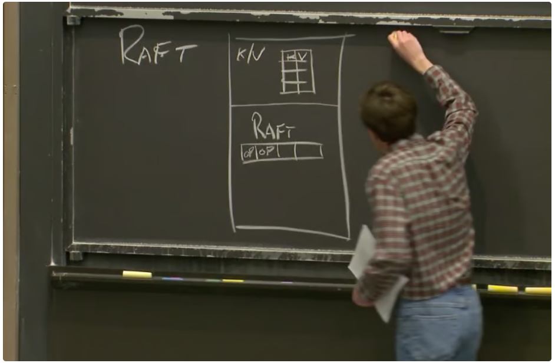
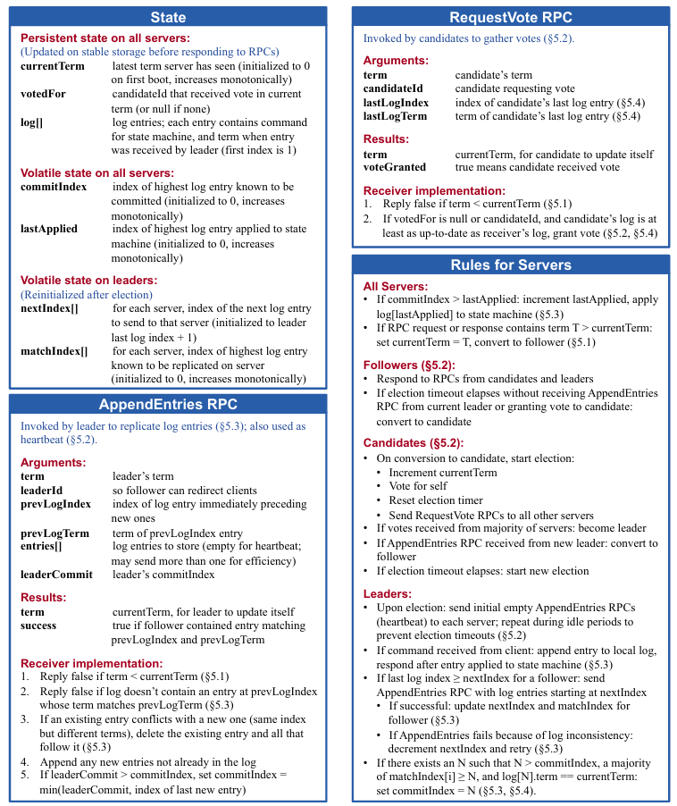

分布式系统的神课，讲解了很多篇经典论文，包括GFS、VMware FT、Raft、Zookeeper等，其提供的Lab能很好地帮助理解 Raft 协议，授课老师也是一位大神。

**CAP理论**

先来认识这三个概念

- `Consistency`：一致性，所有节点让任意时刻的数据都是一致的，是线性一致而不是最终一致
- `Availablity`：可用性，每个请求都能在有限时间内得到非错误的响应
- `PartitionTolerance`：分区容错性，网络出现分区时，系统仍然能继续运行

核心结论：在分布式系统中，当网络分区发生时，**C 和 A 不能同时满足，只能在两者之间做取舍**

## GFS

希望将数据进行分割存储，即**分片**，将一份数据切割成多个块存放在不同的服务器，从而并行地进行读取，提升吞吐量。但是会遇到某个服务器发生故障，因此我们要保证系统的**容错**能力，而实现容错的有效方法就是**复制**，将数据的多个副本存储在不同的服务器中提升容错能力。但又会遇到服务器之间数据不一致的问题，但若想要解决数据不一致的问题，就需要服务器之间进行昂贵的通信从而来消除这种不一致的问题，但是这样的通信会降低性能，所以需要在这两之间做一个取舍。

因此 Google 在 2003 年提出了 Google File System ，将数据进行分片存储，只支持顺序读写，且是为了处理 TB 级别的数据而诞生的，但 GFS 只适合容错高的系统，不同服务器的数据不一定完全相同，且他自身不对数据正确与否做校验，而是把这些工作交给了上层应用。

GFS 只使用了一个节点作为 Master，因此当 Master 发生故障的时候，GFS容易宕机，即**单点故障**，且随着数据的不断增加，Master所在服务器的内存和硬盘的空间也会逐渐不足。在 GFS 中，Chunk Server 是专门用来存储数据的服务器，而 Master 就是保存文件名和存储位置的对应关系，比如可以通过询问 Master 节点某一个文件下有多少 Chunk ID，以及对应的 Chunk Server 在哪，然后就可以请求对应的 Chunk Server 获取数据。


且 Chunk Server 分为 Primary Chunk 和 Secondary Chunk，Primary Chunk 负责接收写请求，且只能在特定的租约时间内担任 Primary Chunk，到期后需要与 Master 进行续约，因此 Master 还需要记住 Primary Chunk 的租约时间，同时还需要记住每个 Chunk 的版本号，GFS使用版本号来判断数据之间是否同步到位，是否一致。并且为了防止 Master 宕机导致数据丢失，每当有数据变更时，Master 还需要将对应的变化写入磁盘，并生成 CheckPoint。

进行读请求的时候，客户端会把自己想要读取的文件名和偏移量一并发送给 Master，Master 就会通过这些数据找到对应的 Chunk Server 返回给客户端，同时客户端会缓存 Chunk 和服务器的对应关系。接着客户端与对应的 Chunk Server 进行通信，Chunk Server 会根据请求信息找到对应的数据返回给客户端。

对于写请求，必须在 Primary Chunk 上执行写操作，然后让其它副本进行同步。如果 Primary Chunk 宕机了，Master 就会在其它 Chunk Server 找到存有最新副本的 Server，将其作为 Primary Chunk，让客户端与这个 Server 通信。由于每个 Chunk 的版本号都是 Master 下发的，因此在寻找哪个 Server 存有最新数据时，就可以通过 Chunk 的版本号和 Master 记录的最新版本号进行对比，看是否一致从而来进行判断。在进行写入数据时，Primary 会让其它 Secondary Server 在同样位置执行写入操作，若写入失败，或者Secondary Server 宕机，那么 Primary Server 会给客户端返回错误，客户端需要重新发起写入请求，但有些 Secondary Server 可能写入成功了，这就意味着不同的 Secondary Server 的数据可能不一致，但是在 GFS 里面是可以容忍的。

由于网络故障的原因，在分布式系统中非常容易出现**脑裂**的情况。为了保证 Primary Server 的存活，Master 会定时 Ping Primary Server ，若因为网络原因，Master 接受不到 Primary Server 的回复，但这有可能只是因为网络故障的原因，那么 Master 会认为其下线，会重新指定一个 Secondary Server 作为 Primary Server，其实原来的 Primary Server 还在对外服务，这时候就会产生俩个 Primary Server，即脑裂。因此在 GFS 里面，当 Master 发现联系不到 Primary Server，会在租约过期之后重新指定 Primary Server，且 Primary Server 在租约过期后不能响应客户端请求，这样就有效避免了脑裂。


## VMWare FT

这节课的主要内容是**复制（Replication）**

有两种复制的方法，**状态转移和复制状态机**。状态转移是把主副本的内存全量复制给其它副本，这是简单的方法，但是在进行网络传输的时候，主副本的内存可能更新了，这样无法保证副本之间的强一致性，也会给网络通信带来很大的压力。复制状态机则只是将客户端操作或者其他外部事件进行复制。但复制状态机在多核任务上并不是最合适的，相同指令在不同核心上的执行结果可能不一样，因此后面的 VMware FT 使用了状态转移。

通过在硬件上运行虚拟机监视器，Virtual Monitor Machine，就可以执行各种各样的操作系统。在 VMware FT 中，有两台服务器，Primary 和 Backup，当客户端发送请求时，由 Primary 对此做出响应，并把对应的指令和数据流复制给 Backup，而 Backup 执行相同指令的同时也做出响应，但会被 VMM 拦截，因为其不是 Primary。Primary 到 Backup 之间同步的数据流的通道称之为Log Channel，事件被称为 Log Channel 上的Log Event/Entry。当 Backup 没有收到 Primary 的 Log Event，就说明 Primary 宕机了，因此此时 Backup 需要变成 Primary 对外提供服务。


## Raft

**脑裂**

当网络出现分区，副本之间无法通信但却能与客户端通信，就容易出现脑裂，即多个节点认为自己是主节点。

**多数派投票**

因此衍生出过半机制，即多数派投票。系统要求存在奇数个服务器，只有某个节点获得超过半数节点的投票，这个节点才能当选主节点，这有效预防了网络分区带来的脑裂问题，保证系统在何种情况下都只有一个主节点。如果系统有 2 * F + 1 个服务器，那么系统最多可以接受F个服务器出现故障，仍然可以正常工作。如果超过半数的服务器发生故障，那么系统无法选出主节点，进而崩溃。还有一个很**奇妙的特性**，当前任期内投票的多数节点必定和上一任期投票的多数节点有交集，因此当前任期内选出来的 Leader 可以通过这个交集知道旧 Leader 的记录，不可能同时出现两个合法 Leader，可以有效防止脑裂。

**raft**

在实际应用中，raft是作为一个层和应用共存的，而作为一个多副本系统，其它副本也有着完全一致的结构。在 raft 层里面，其主要记录操作的日志。客户端会对应用发送请求，而只有 Leader 会处理客户端的请求，应用程序会转发客户端的请求和对应的操作到 raft 层，让 raft 层记录并把这些信息同步到其它副本中，当超过半数节点同步完成后对应用程序进行通知，此时应用程序才能**真正执行操作并返回客户端响应**，并且 Leader 会自增自己的已提交索引（commitIndex）。这样子虽然损耗了系统性能，但这是实现强一致性必须付出的代价。



刚刚叙述了 Leader 节点是如何更新应用程序状态和 raft 层日志的，那么 Follower 节点是如何更新的呢？在某个请求中，Leader 的 raft 会把数据和操作同步给 Follower 的 raft，此时 Follower 的 raft 仅仅只是记录了日志（**未提交**），而应用程序并没有执行操作，也可以这么理解，主副之间的应用程序状态并不是强一致性的，但 raft 的日志是强一致性的。也就是说，Leader 在更新状态后并不会直接通知 Follower 对其应用程序进行操作，而是在**下次请求或者某次心跳检测**将自己的已提交索引（commitIndex）发送给 Follower，Follower 根据这个变量依次执行日志记录的操作。这就意味着副本最多落后主节点一个心跳检测的周期。

Leader 是通过一个叫 AppendEntries 的 RPC 请求与 Follower 进行通信的，这个方法可以用于心跳检测，追加日志，并且还会发送前一条日志的索引和任期号，用于纠错 Follower 的日志，使其与 Leader 保持同步。且只有 Leader 才能通过 AppendEntries 与 Follower 进行通信。

为何 Raft 需要 Leader 和 Follower 都保存 Log 呢？一个是为了保证副本的强一致性，需要通过 Log 保证命令执行顺序的一致，同时还需要保证服务器重启之后能通过 Log 恢复到之前的状态，并且若因为网络原因 Follower 短时间离线，Leader 需要重传日志保证同步。如果服务器重启之后不知道自己执行到日志中的哪一步，那么还如何恢复到之前的状态呢？Raft 会选出新 Leader，它的选举规则保证 Leader 的日志是最新的，同时还会根据日志确定 commitIndex 的位置，若日志被过半服务器记录，那么 Leader 就认为其已经提交了，接着根据 Raft 刷在磁盘的 checkpoint 进行 replay，进行状态恢复。

**应用层接口**

应用层和 raft 层之间有两个接口：第一个接口是应用层将客户端请求转发给 raft 层，称之为`start(command)`函数，start函数返回操作对应的`index`；第二个接口是 raft 层告知应用层之前的请求已经和其它副本同步完成，可以执行操作并返回响应给客户端，这个向上的接口以`go channel`的形式存在，这个通道叫做`applyCh`，你可以通过这个通道发送`ApplyMsg` 消息，消息中包含`command`和`index`

**Leader 选举**

raft 的生命周期中有不同的 Leader，它通过任期号来区分不同的 Leader，而同一个任期号只能有一个 Leader。每个 raft 节点都有一个选举定时器，如果在这个定时器时间耗尽之前，当前节点没有收到任何当前 Leader 的消息，这个节点会认为 Leader 已经下线，并开始一次选举。开始选举时，服务器会增加任期号，然后服务器会发出请求投票（RequestVote）RPC，且 Leader 候选人总是会在选举阶段投票给自己。若**请求者任期没当前节点大或者当前节点已经投过票了**，则拒绝为其投票。只有当**请求者最新日志任期大于当前节点最新日志任期或者请求者最新日志任期等于当前节点且请求者日志长度大于等于当前节点日志长度**，当前节点才会为请求者投票。

当 Leader 通过 AppendEntries 进行心跳检测时，Follower 的**选举定时器就会重置**。为了防止 **Split Vote** 的情况出现，即所有的 Follower 的选举定时器同一时刻过期，它们同时给自己投票，并且忽略了其它节点发来的投票请求，那么这样永远选不出 Leader，且选举定时器过期后会循环这个现象，导致死循环，因此需要对选举定时器的过期时间进行随机化，下限不能超过心跳检测的周期，防止还未检测就开始选举，上限不能超过系统崩溃周期，因为 Leader 宕机后，此时处于群龙无首的状态，且选举定时器未过期，在这段时间内未发生选举，系统也就无法对外服务。若超过崩溃周期，系统则一直无法正常对外服务。

**异常情况**

若 Leader 突然发生故障，新的 Leader 如何进行日志同步？只需记住：**只要日志出现在超过半数的服务器上，那么就认为这条日志需要进行提交**。若 Follower 与 Leader 有冲突日志，则 Follower 的冲突日志会被 Leader 的覆盖，以保证一致性。在进行同步时，若 Follower 和 Leader 的日志不匹配，则 Leader 会对 nextIndex 进行回退，直到二者匹配，然后用 Leader nextIndex 的后续日志对 Follower 的 nextIndex 的后续日志进行覆盖。


**Fast Backup**

若 Follower 和 Leader 的日志不一致，则需要进行同步，系统会维护一个 nextIndex 变量，但是正常情况下 nextIndex 只会一步步往后退，非常耗时。因此快速备份出现了，Follower 会返回以下信息：`XTerm`，Follower 与 Leader 冲突的日志所在的任期；`XIndex`，Follower 与 Leader 冲突任期第一条日志的槽位；`XLen`，Follower 没有日志的空白槽位长度。这样子可以通过两次网络通信完成日志同步，极大提高效率。


**Persistence**

在 Raft 中，有且仅有三个变量需要持久化：`Log`（日志）、`CurrentTerm`（当前任期号）、`votedFor`（把票投给了谁）。其它变量不需要持久化，可以让 Leader 进行恢复。

**Log Compaction & Snapshot**

在 Raft 中，随着系统运行，日志会不断膨胀，若系统重启，则需要从头开始重放，十分耗时。因此需要对应用程序进行快照刷盘，当日志大小到达阈值时，需要对应用程序当前状态进行保留，然后标记好这是哪一条日志之后的状态。这样当服务重启后，**只需加载快照，并重放快照保存时标记的日志位置之后的日志即可**。需要注意的是，保存快照是由应用程序执行的，Raft 层并不知道快照是什么。如果 Follower 落后 Leader 太多且 Leader 删除了无用日志，那么 Follower 如何与 Leader 进行同步呢？Leader 通过 InstallSnapshot RPC 对快照进行传输，由 Follower 的 Raft 进行接收，并让其应用程序进行加载，之后 Leader 通过 AppendEntries RPC 发送后面的日志完成同步。

**Raft协议说明书**



```go
type RequestVoteArgs struct{
    // 候选者任期
    Term int

    // 候选者ID
    CandidateId int

    // 最新日志的任期
    LastLogTerm int

    // 最新日志的索引
    LastLogIndex int
}

type RequestVoteReply struct{
    // 投票者任期 用于更新候选者任期
    Term int

    // 是否同意投票
    VoteGranted bool
}

type AppendEntriesArgs struct{
    // Leader 任期
    Term int

    // 某个 Follower 要接收的 entries 的前一条日志的索引
    PrevLogIndex int
    
    // 某个 Follower 要接收的 entries 的前一条日志的任期
    PrevLogTerm int

    // Leader 日志
    Entries []Entry

    // Leader 的 id
    LeaderId int

    // Leader 的 CommitIndex
    LeaderCommit int
}

type AppendEntriesReply struct{
    // Follower 任期 用于更新 Leader 任期
    Term int


    // 用于判断 Follower 的日志是否和 Leader 一致 
    Success bool

}

type Raft struct{
    // 其它节点
    peers []*labrpc.ClientEnd
    
    // 节点当前任期
    currentTerm int

    // 节点当前任期投给谁
    votedFor int

    // 节点日志
    log []Entry

    // 选举定时器上一次重置的时间
    electionTimer time.Time

    // 上一次心跳的时间
    heartBeatTimer time.Time

    // 身份
    state int

    // 当前任期得到的投票数
    votes int
    
    // 快照
    snapshot []byte

    // 快照中最后一条日志的索引
    lastInlucdedIndex int

    // 快照中最后一条日志的任期
    lastIncludedTerm int

    // 已经提交的日志的最新索引
    commitIndex int

    // 提交的日志中在应用程序已经执行完毕的最新索引
    lastApplied int

    // Leader 专属
    // Leader 给每个 Follower 下一次发送日志的索引
    nextIndex []int

    // Leader 确认 Follower 已复制的最高日志索引
    matchIndex []int
    
}

```


## lab

lab1、lab2都很简单，lab3的3A、3B、3C难度中等，但是3D需要考虑很多边界情况，因为测试样例给的很全，需要考虑RPC丢包，请求延迟到达，快照被覆盖等等临界情况，非常的困难，但是我觉得啃透了帮助绝对很大。lab4和lab5则是需要考虑真实生产情况下网络断联等边界情况，代码要健全，能够保证返回值可靠，这部分也是耗费我大量时间，不过收获颇丰。

**lab1**

实现mapreduce对单词的统计

**lab2**

实现简单的KV Server，通过维护版本来记录key的更新次数，并且在不可靠网络下需要告知客户端 Put 操作是否执行

**lab3**

实现 Raft，3A 需要实现领导者选举和心跳检测，3B 需要实现日志、领导者选举限制、nextIndex 回退优化，3C 需要实现持久化（不包括快照），3D 需要实现日志压缩和快照持久化

**lab4**

实现基于 raft 协议的 kvServer。4A 需要实现 rsm，raft 与 statemachine 之间的粘合层，负责通知 raft 更新日志，监听 applyCh 让 statemachine 执行操作，4B 需要实现 statemachine 和发送请求的客户端 clerk，4C 需要实现快照保存与恢复功能。

**lab5**

实现基于 raft 协议的分片 kvServer，kvctrler 对请求的 key 进行路由，路由到不同的 server 进行存储。同时 lab2 实现的单机无容错的 kvsrv 在本实验中负责配置的存储。

根据 key 的哈希值进行分片，路由到负责这个分片的 servers（基于 raft），一个 servers 集群可以负责多个分片

