[本页PDF](/pdfs/me/formulaic/cn.pdf)

## 计网常见知识

### 常见含义

**ISP**：互联网**服务提供商**，如中国电信、中国联通等

**MAC**： **网络接口卡（网卡）** 在制造时固化的一个**全球唯一标识符**

**RTT**：**最小往返时延**（考虑网络拥堵）

**MTU**：一个网络包的最大长度，以太网中一般为 1500 字节

**MSS**：除去 IP 和 TCP 头部之后，一个网络包所能容纳的 TCP 数据的最大长度

### TCP/IP模型

**OSI和TCP/IP**

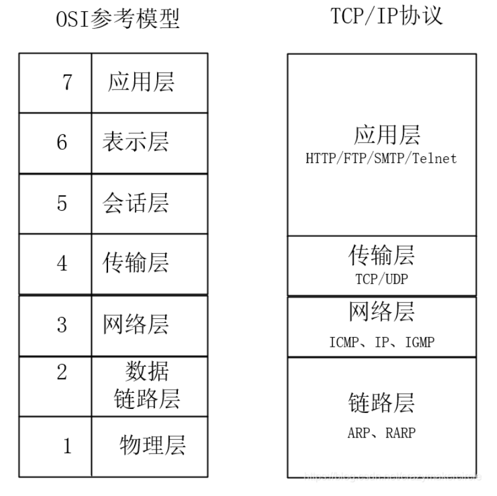

如上图所示：

- 我们使用的`HTTPS`、`FTP`、`DHCP`、以及`HTTP`都属于**应用层**
- `TCP`、`UDP`都属于**传输层**
- `IP`则属于**网络层**

**一个应用场景，完美契合TCP/IP模型**

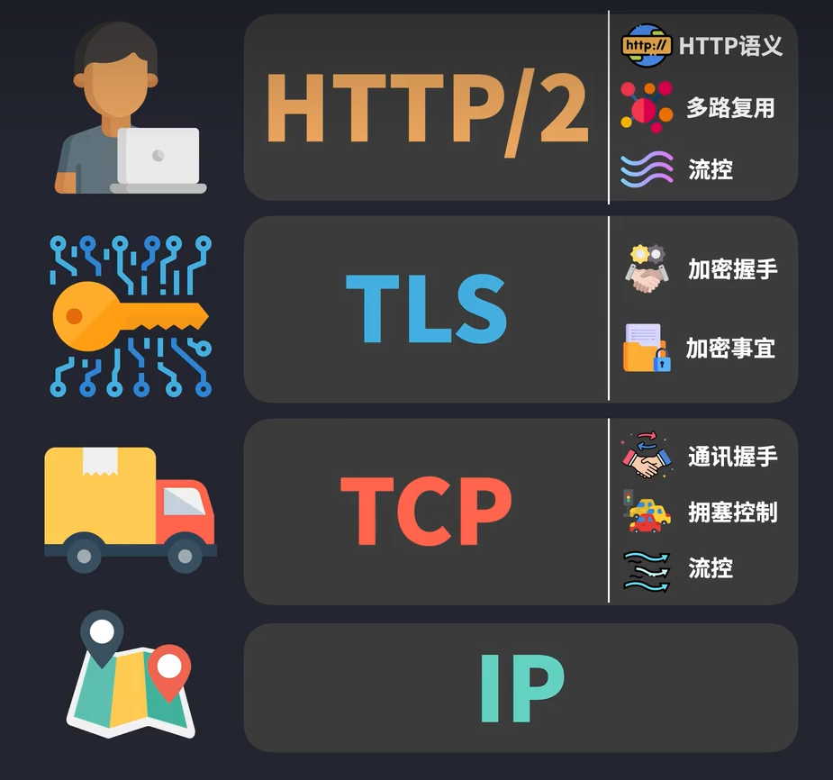

**每一层的封装格式**

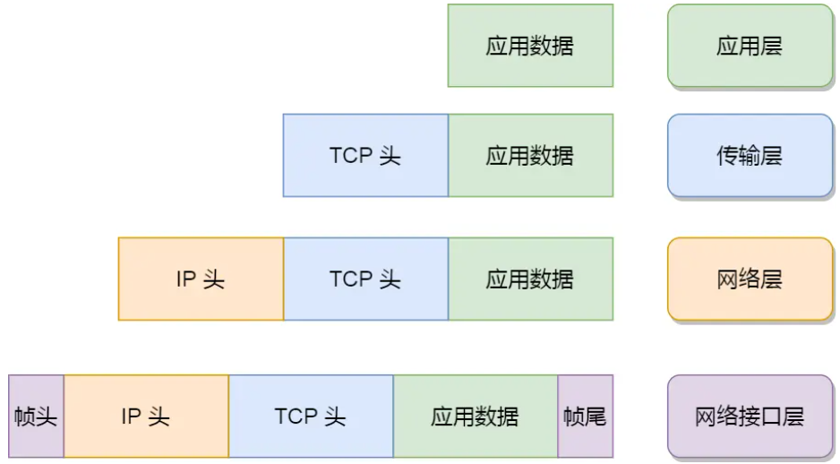

### Socket

**套接字**，就是ip地址+端口号

### TCP

**核心：三握四挥**

**TCP首部会用掉20个字节**

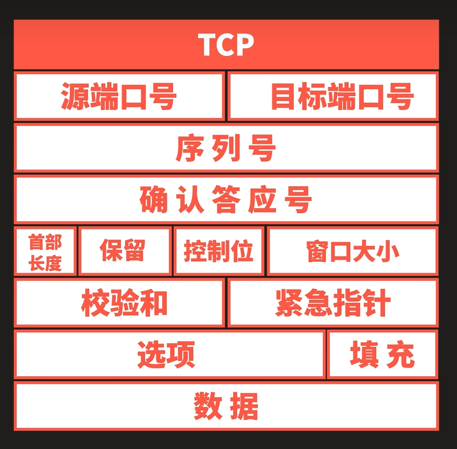

- **序列号**：建立连接时由计算机生成的随机数作为初始值，通过 SYN 包传给接收端主机，每发送一次数据就累加一次该数据字节数的大小，**用于解决网络包乱序的问题**
- **确认应答号**：指下一次期望收到的数据的序列号，发送端收到这个确认应答后可以认为在这个序号之前的数据已经被接收，**用于解决丢包的问题**
- **源端口号和目标端口**负责告诉系统应该发给哪个应用，**源IP和目标IP在网络层里**

**TCP报文里有SYN、ACK和FIN标识**

- 设置为1就是开启这些标识
- 设置为0就是关闭这些标识

应用层传输的数据可能会非常大，如果超过了TCP的**MSS（TCP 最大报文段长度）**，就需要对**数据包进行分块**，在 TCP 协议中，我们把每个分块称为一个 **TCP 段**

#### 三次握手

**流程**

- 客户端发送SYN报文，并设置好客户端序号，客户端进入`SYN_SEND`状态
- 服务端发送SYN+ACK报文，设置服务端序号，将确认号的值设置为客户端SYN报文的客户端序号+1，服务端进入`SYN_RECV`状态
- 客户端发送ACK报文，序号用服务端报文的确认号，确认号用服务端报文的服务端序号+1，客户端和服务端都进入`ESTABLISHED`状态

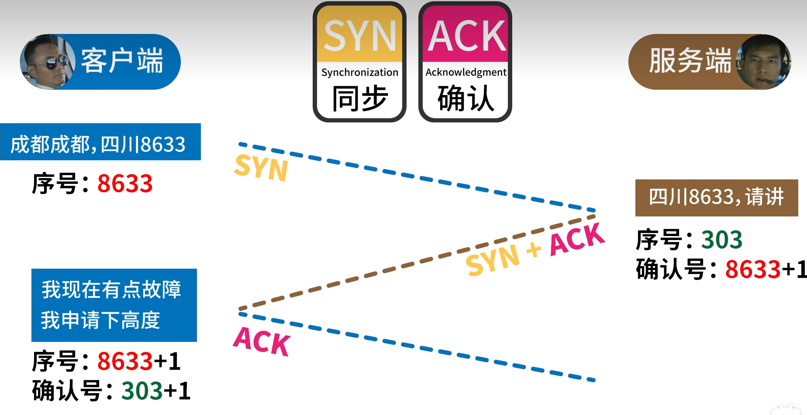

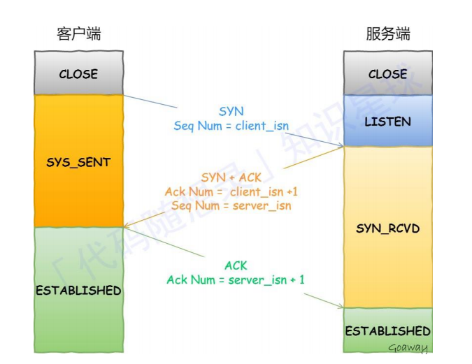

**为什么需要三次握手**

> 三次握手才能保证双方具有接收和发送的能力

- 主要原因是**能阻止历史连接的建立**
  - 客户端发送 SYN （seq=90）报文，然后宕机了，由于网络被阻塞，此时服务端并未接收到，接着客户端重启后，又重新向服务端建立连接，发送了 SYN（seq = 100）报文
  - 但旧 SYN 比新 SYN 先到达，服务端响应了旧 SYN 之后，客户端发现响应结果并不是新 SYN 需要的，因此发起 RST 中止连接
  - 两次握手的情况下，服务端没有中间状态给客户端来阻止历史连接，导致服务端可能建立一个历史连接，造成资源浪费

- 帮助双方同步初始化序列号
  

- 能避免资源浪费
  - 两次握手会造成消息滞留情况下，服务端重复接受无用的连接请求 SYN 报文，而造成重复分配资源

**不使用两次握手和四次握手的原因**：

- 两次握手：无法防止历史连接的建立，会造成双方资源的浪费，也无法可靠的同步双方序列号
- 四次握手：三次握手就已经理论上最少可靠连接建立，所以不需要使用更多的通信次数

**初始序列号ISN是如何初始化的**：ISN = M + F

- `M`是一个计时器，计时器每隔4微秒加一
- `F`是hash算法，根据源IP、目标IP、源端口、目标端口生成一个值

**半连接队列（SYN队列）和全连接队列（accept队列）**

- 服务端接收到 SYN 报文，就会创建一个半连接对象，然后放进半连接队列
- 接着发送 SYN + ACK 报文给客户端，等待客户端回复 ACK 报文
- 服务端收到 ACK 报文后，从半连接队列取出一个半连接对象，创建一个新的连接对象放进全连接队列
- 应用通过调用`accept()`接口，从全连接队列取出连接对象

#### 四次挥手

**流程**

- 主动断开方（可以是客户端，也可以是服务端）发送一个FIN和ACK报文，并设置好**序号和确认号**，进入`FIN_WAIT_1`状态
- 被动断开方发送一个ACK报文，报文的序号为断开请求的确认号，**报文的确认号为断开请求的序号+1**
- 被动断开方还可以进行数据的发送，剩余数据发送完后，被动断开方会向主动断开方发送一个FIN+ACK结束响应报文，主动断开方进入`FIN_WAIT_2`状态，被动断开方进入`CLOSE_WAIT`状态
- 主动断开方在收到FIN+ACK断开响应报文后，还需要进行最后的确认，向被动断开方发送一个ACK确认报文，**序号为被动断开方的确认号，确认号为被动断开方的序号+1**，被动断开方进入`LAST_ACK`状态
- 主动断开方随之进入`TIME_WAIT`状态，等待2MSL一段时间后，进入`CLOSE`状态，连接关闭（主动关闭连接的，才有 TIME_WAIT 状态）

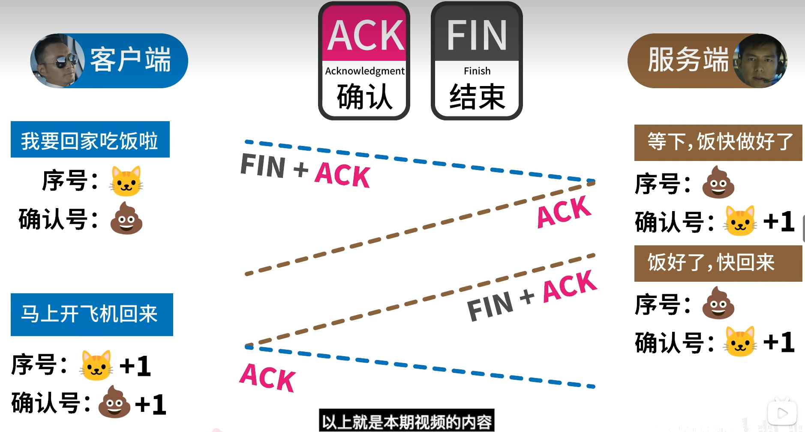

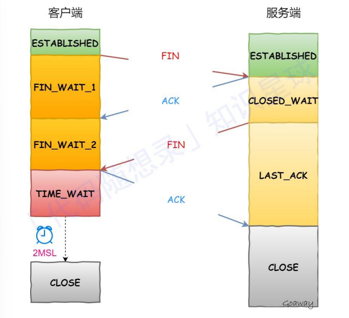

**为什么要进行四次挥手？**

- 因为服务端可能还有数据需要发送，客户端发送`FIN`后表示其不再发送数据，**但还可以接收数据**
- 服务端收到客户端的 FIN 报文时，先回一个 ACK 应答报文，而**服务端可能还有数据需要处理和发送**，等服务端不再发送数据时，才发送 FIN 报文给客户端来表示同意现在关闭连接

**为什么需要TIME_WAIT状态**

1. **防止历史连接的数据被新连接错误的接收**

如果网络出现延迟，导致数据包在网络滞留，如果没有TIME_WAIT状态，这些滞留的数据包就会被传递给新连接，导致新连接被旧连接的数据干扰

2. **保证被动断开方能被正确关闭，即保证最后的ACK可以让被动断开方接收**

若主动断开方的**最后一次ACK报文丢失**，被动断开方没有接收到报文就会**重发FIN报文**，而主动断开方**收到重传的FIN报文后就会传回RST报文**，被动断开方收到这个RST报文就会报错

**为什么TIME_WAIT等待的时间是2MSL**

- MSL是`Maximum Segment Lifetime`，报文最大生存时间，是**任何报文在网络上存在的最长时间**，超过这个时间报文将被丢弃
- 2MSL：发送方和接收方一来一回需要2MSL时间
- 主动断开方发送 ACK 后，如果这个 ACK 在网络丢失的话，被动断开方需要重发 FIN，发送 ACK + 重发 FIN =2MSL

#### TCP重传机制

##### 超时重传

**两种情况**

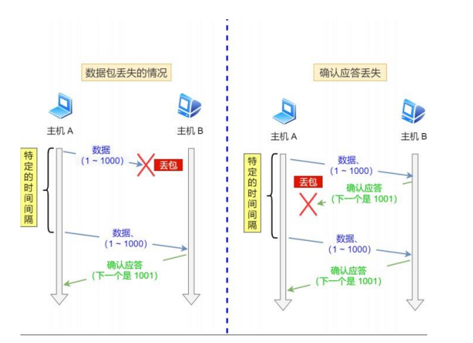

**注意**

- **RTT**：往返时延，数据包的往返时间
- **RTO**：超时重传时间，**太长了会降低传输效率，太短了会造成不必要的重传**
- **RTO的值应该略大于RTT的值**

##### 快速重传

**核心**：不以时间为驱动，以数据驱动重传

**原理**：当收到三个相同的ACK报文时，会**重传丢失的报文段**

**局限性**：但是重传的时候，不知道要重传多少数据包，因此引入了**SACK（选择性确认）技术**

**SACK**

为了解决**重传哪些报文的问题**而提出

需要在TCP头部加一个`SACK`的东西，**可以将已收到的数据的信息发送给发送方**，发送方就可以知道哪些数据没收到，**只重传丢失的数据**

#### TCP流量控制

**目的**：主要是为了解决**发送方发送数据过快**导致接收方缓冲区溢出的问题（考虑接收方的接收能力）

**核心思想**：接收方通过告知发送方自己还有多少**剩余的缓冲区空间**来主动控制**发送方的发送速率**

**核心机制**：滑动窗口

##### 工作流程

1. **连接建立时**
   - 双方都会维护一个接收缓冲区
   - TCP首部中的 `Window` 字段表示当前可接收的窗口大小（`rwnd`），最大为65535字节
2. **数据传输中**
   - 发送方发送数据后会等待ACK
   - 接收方每次ACK时，会带上**当前的接收窗口大小**
   - 发送方根据ACK中的 `rwnd` 调整自己的发送速率
3. **窗口滑动**
   - 当接收方应用程序从接收缓存中取走部分数据时，空出来的空间就意味着窗口可以“滑动”
   - 接收方在下一次ACK中通知发送方新的窗口大小

**窗口结构**

- 发送方和接收方都有**自己的窗口结构**
- 发送方需要将数据分为**发送+已确认，发送窗口，不能发送**
  - 发送窗口还细分为**可用窗口**和**已发送+未确认**
    - **已发送+未确认**可用于重传
    - **可用窗口**则是表示可以发送的数据
- 接收方需要将数据分为**接收+已确认，接收窗口，不能接收**

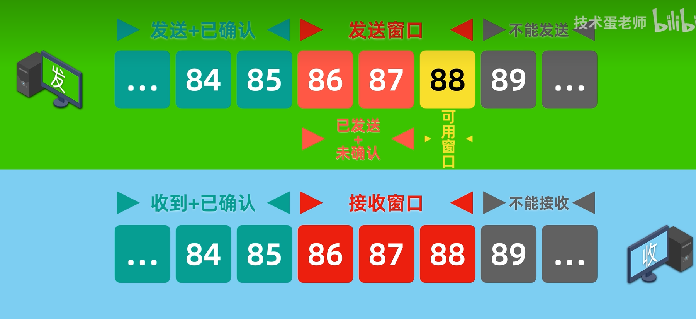

滑动窗口增大了TCP的吞吐量，可以在同一时间发送多个数据包，**实现并行发送**，使用**累计确认机制保证数据传输完整性**

> 即便前面的某个确认应答（ACK）在路上丢了，只要后续的 ACK 顺利到达，发送方就知道前面的数据也已经被安全接收了。
>
> 假设客户端传了7、8、9三个数据包可以服务端，服务端成功返回ACK7、ACK8、ACK9，但是ACK8在网络上丢失了，但是客户端收到了ACK9，那么客户端认为序号9之前的数据服务端都已经接收到，客户端因此可以继续发送数据

#### 拥塞控制

**考虑网络拥堵情况**

**网络拥塞**：网络中的链路或者路由器**过载**时，会**丢弃数据包**

**核心**：采用一系列方法控制**拥塞窗口**的大小，进而控制**发送窗口**的大小，`发送窗口=min(拥塞窗口,接收窗口)`

**算法**

- 慢启动
- 拥塞避免
- 拥塞发生
- 快速恢复

**流程**

- 初始时设置`ssthresh`（慢启动阈值），采用**慢启动**，初始化**拥塞窗口**`cwnd`为1MSS（TCP数据部分的**最大长度**）
- 初始拥塞窗口为1，呈现**指数增长**，每收到一个 ACK，cwnd就增加一
- 超过`ssthresh`后呈**线性增长**，进入**拥塞避免**阶段，每当收到一个 ACK 时，cwnd 增加 1/cwnd
- 当网络出现拥塞，发生数据包重传，说明进入**拥塞发生**阶段
  - 当发生**超时重传**时
    - 说明网络**拥塞严重**，重新回到**慢启动**
    - `ssthresh = cwnd / 2`
    - `cwnd`被重置为1MSS
  - 当收到3个重复的ACK时
    - 说明网络拥塞**不那么严重**，触发**快速重传**和**快速恢复**
    - `ssthresh = cwnd / 2`
    - `cwnd`被重置为 `ssthresh` + 3MSS
    - 然后进入**拥塞避免**阶段（线性增长）

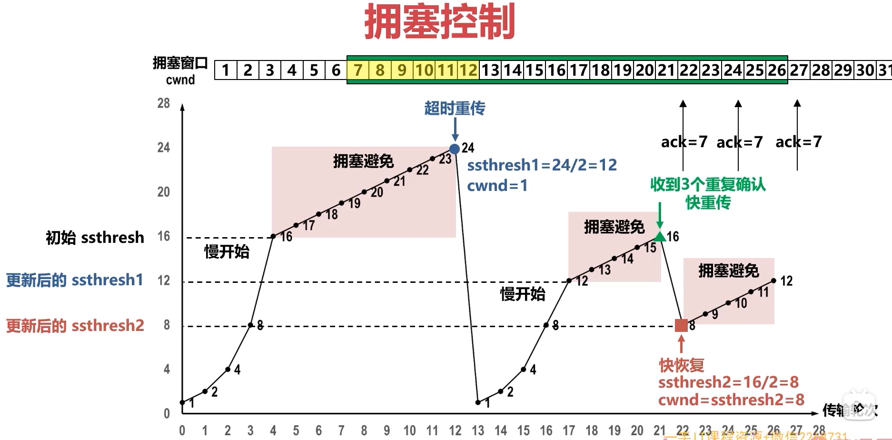

#### KeepAlive

**TCP保活机制**：启用`KeepAlive`的时候，操作系统会定期发送一些**特定的探测数据包**来维护连接灵活性

- 发送的数据包一般是空的，无实际的数据内容
- 如果一端接收到了探测数据包，**它会回复一个ACK数据包**；如果一段时间内发送端没有接收到确认数据包，发送端会认为连接已经断开，**从而触发连接关闭**
- 长时间的持久连接会占用服务器资源，因此在实际生产一般会**设置`KeepAlive`的超时时间**

#### BBR

是Google提出的**新一代TC 拥塞控制算法**

- 不靠丢包来判断网络拥堵情况
- 靠实时估算网络能提供的**最大带宽（BtlBw）**和**最小往返时延（RTprop）**来控制发送速率
- $\text{发送速率} \approx BtlBw \times RTprop$

### UDP

**无连接、不可靠**的传输协议，常用在**端口寻址、实施在线游戏、实时音视频传输等**

**特点**

- **无连接**：通信前不需要建立连接，直接发送数据包即可
- **不可靠交付**：不提供确认、重传等机制
- **无拥塞控制**：不管网络状况多差，UDP都会以恒定的速率发送数据
- **支持广播**

**UDP首部只用掉8个字节**

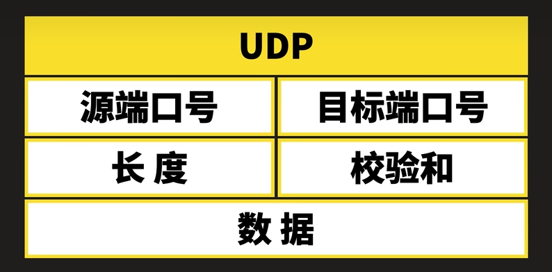

### IPV4和子网掩码

#### **IPV4**

`ipv4`是由**4组8位二进制组成的**，组之间用`.`隔开

`ip`地址 = 网络号 + 主机号

- **网络号**：同一个物理网络的所有设备，**网络号是相同的**
  - **路由寻址**：路由器只关心**目标IP地址的网络号**，从而实现数据包的转发
- **主机号**：IP地址中在特定网络内用于**标识唯一设备**的一部分
  - **最终交付**：数据包**到达目标网络**后，路由器会查看**目标IP的主机号**，从而将数据包准确地发送给正确的设备

**ip地址类型**

- A类：网络数为**128**，主机数为**16777216**
- B类：网络数为**16384**，主机数为**65536**
- C类：网络数为**2097152**，主机数为**256**

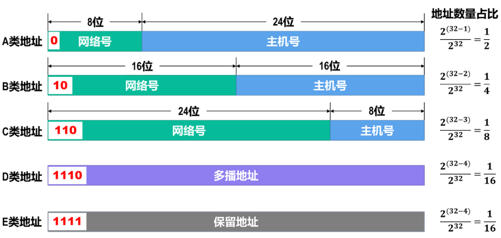

**注意**

- **网络地址**的**主机位**全部为0，会占用1个ip，是整个网络的唯一标识
- **广播地址**的**主机位**全部位1，会占用1个ip，向网络中所有设备发送广播
- 因此，C类网络只能分配`256-2=254`个ip地址

**本地广播与直接广播**

- **本地广播**：在本网段内广播，路由器会屏蔽掉**广播地址**的IP包，使得数据在本网段内传输
- **直接广播**：跨网段广播

#### **子网掩码**

**一个32位二进制数，为了划分网路号和主机号而产生的**

- **相同的网络号**会用**子网掩码的1**进行锁定
- 主机号**为0的二进制位**也会用**子网掩码的1**来进行锁定

也就是说，在子网掩码中

- **1对应的位是网络位**：标识一个子网。同一个子网内的所有IP地址，其网络位必须完全相同
- **0对应的位是主机位**：标识子网内的具体设备。主机位在子网内可变，且必须唯一
- 将子网掩码和IP地址进行**按位与运算**即可得到网络地址

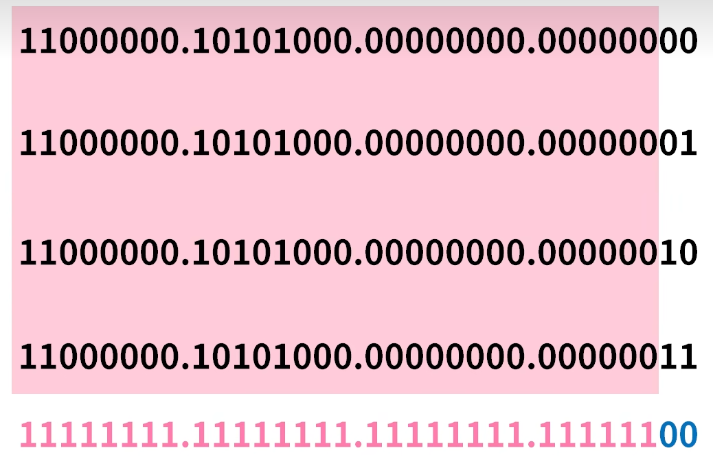

#### **CIDR表示方法**

看子网掩码中有多少个1，在IP地址后加`/1的个数`即可

### IPV6

`ipv6`地址是由**128位二进制数**组成，通常以**十六进制**形式表示，分为**8组**，每组**16位二进制数（4个十六进制数字）**用**冒号**分隔

#### **地址压缩**

- **零压缩**：连续的零组可以用双冒号（`::`）表示，但在一个地址中只能使用一次
- **前导零压缩**：每组中的前导零可以省略，例如0001可以表示为1

#### **地址的组成部分**

**前缀**：前缀用于标识网络部分，类似于IPv4中的网络地址，前缀长度通常以斜杠后跟数字的形式表示

**接口标识符**：用于标识网络中的具体接口，通常为后64位

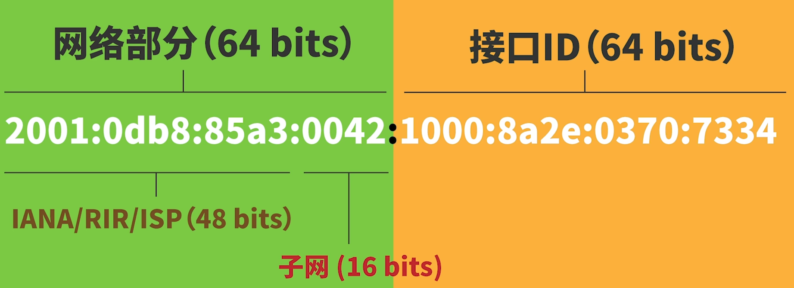

#### 地址类型

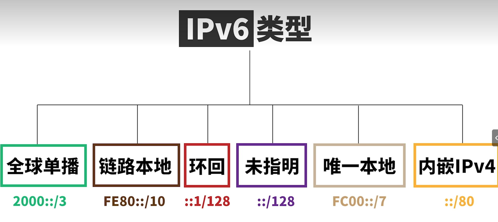

### NAT

**网络地址转换**

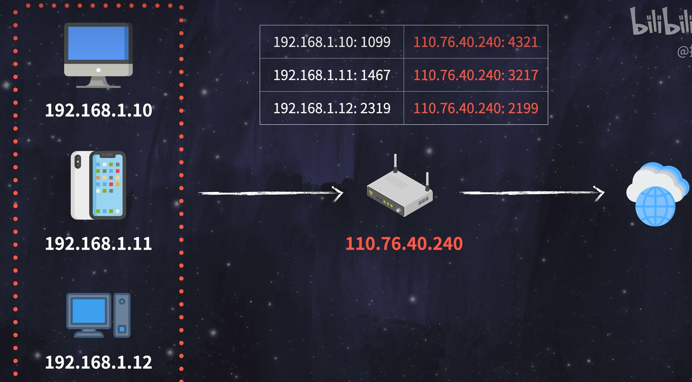

**原理：**

- 内网访问外网通过出口路由时，源地址会转换成特定公有地址，并且将两个ip映射关系加到NAT映射表上
- 在外网向内网通信时，目的地址还是特定公有地址，但是到达出口路由器后，查看NAT映射表，从而转换为私有地址

**问题：**

- **破坏端到端通信**：两个都在NAT后的设备难以直接建立P2P连接
- **服务暴露困难**：外部网络无法直接主动访问NAT后的内部服务

#### 虚拟机网络

**NAT**

**图解**

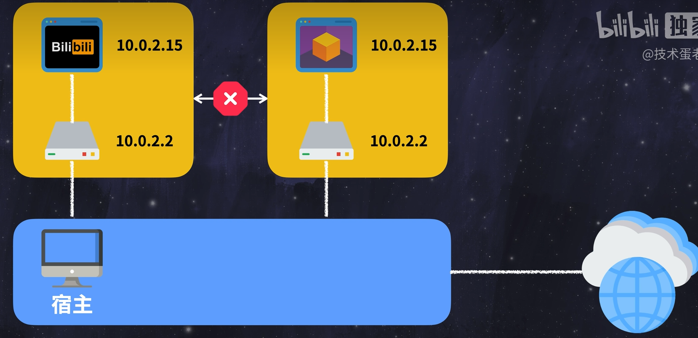

- 虚拟机之间无法互相访问
- 宿主机、局域网设备无法访问虚拟机
- 虚拟机可以通过宿主机访问互联网

**NAT网络**

**图解**

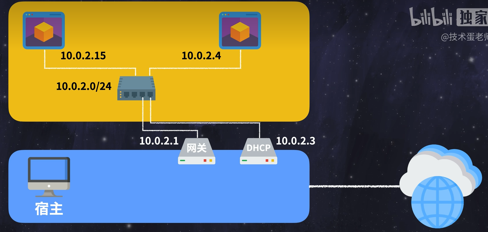

- 在虚拟机前加了一台虚拟的交换机
- 加上了网关和DHCP服务

**桥接**

**图解**

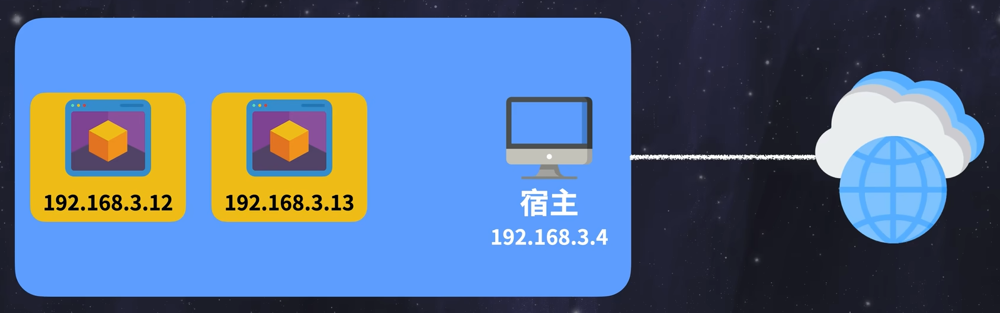

- 虚拟机和宿主机同级，在同一个网络里
- 宿主机和虚拟机在**同一个DHCP服务**获取私有IP地址，因此虚拟机会**消耗**宿主机所在局域网的IP地址

### DHCP

**动态主机配置协议**，是处于**应用层**的协议

**作用**：自动为网络中的电脑、手机等设备分配IP地址

#### 动态配置

可以在路由器中配置IP池，增加私有IP的数量，从而增加联网设备的数量

#### DHCP握手

**流程**

- 客户端发送**`DHCP Discover`**
  - **传输层**使用UDP进行数据传输，客户端使用68端口，服务端使用67端口
  - **网络层**中，不知道源IP地址填写`0.0.0.0`，不知道目标IP地址填写`255.255.255.255`，这样交换机接受到之后就会进行**广播**
  - **数据链路层**与IP地址道理相同

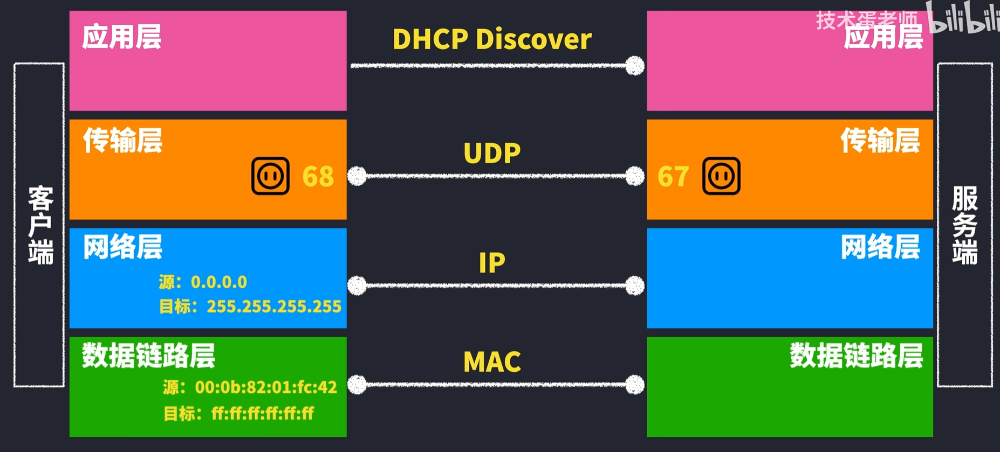

- DHCP服务器发送**`DHCP Offer`**，给客户端提供私有IP地址、子网掩码、网关、DNS
  - **网络层**中DHCP服务器会发送确定的源IP地址和目标IP地址供客户端选择
  - **数据链路层**中的MAC地址也同理

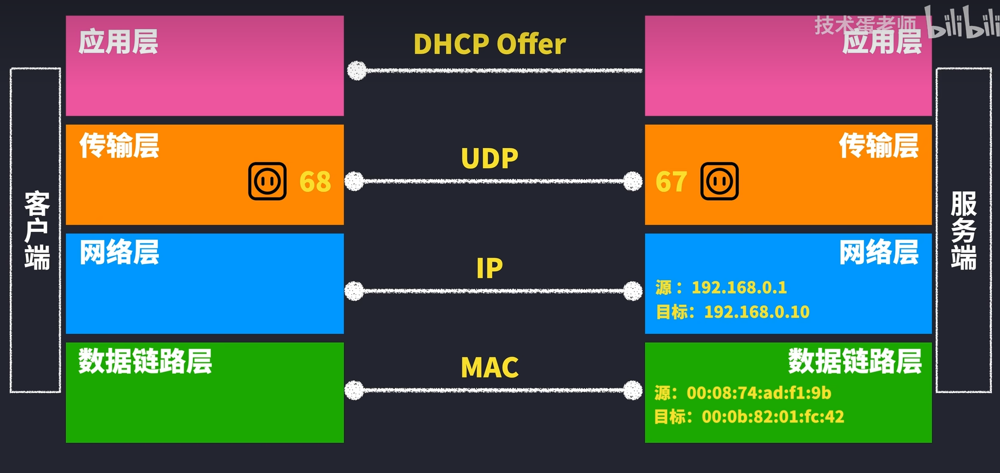

- 客户端进行**`DHCP Request`**，广播所有DHCP服务器客户端选择了哪个IP

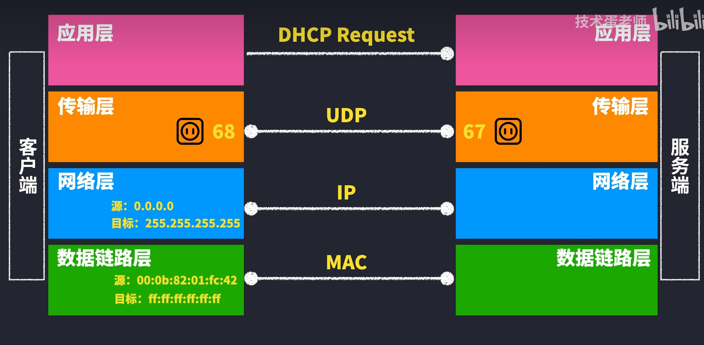

- 服务端发送**`DHCP ACK`**，新设备可以开始上网

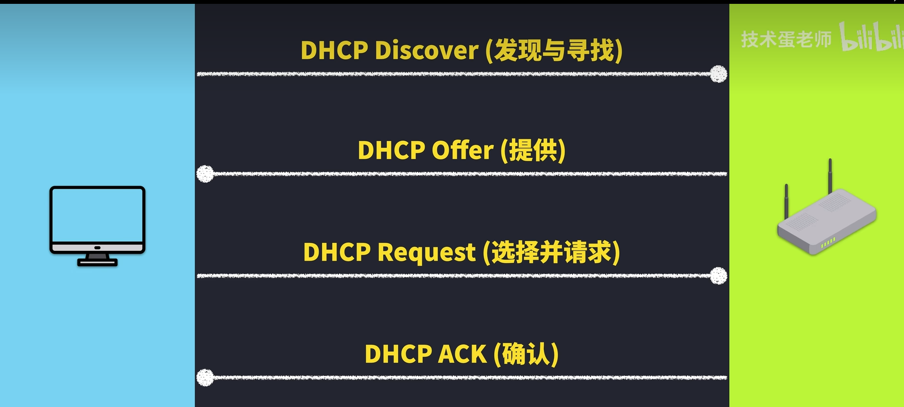

### DNS

**DNS默认使用UDP协议**

- 不出现**分片**情况下，UDP协议最大有效载荷是**512字节**以内
- 根服务器地址需要塞进一个**UDP包里**，最多只能放下**13组**记录

#### **域名结构树**

- 顶层的根`.`是由一群服务器组成的，**这群服务器只用了13个域名**

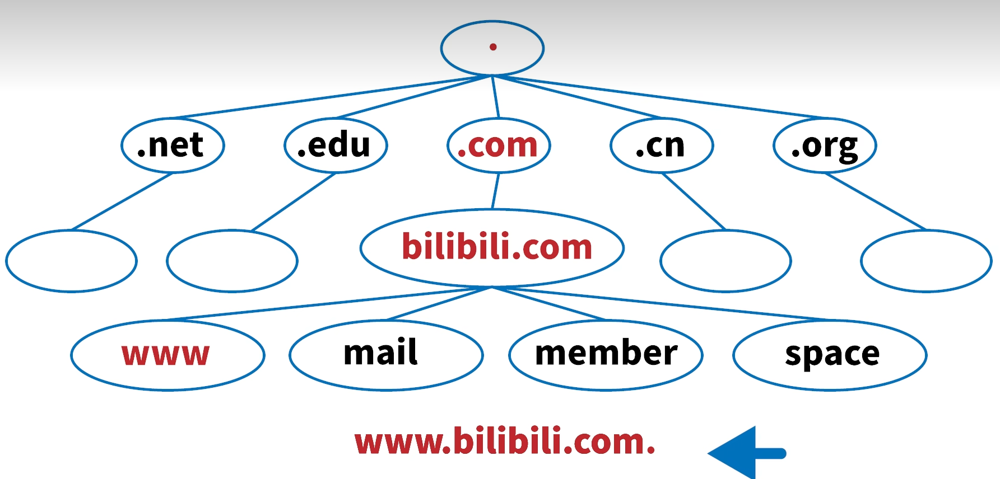

#### **域名服务器类型**

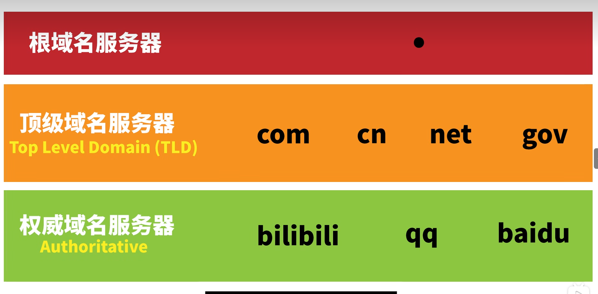

#### **DNS解析过程**

1. **浏览器缓存**：首先在浏览器检查是否有该域名对应的IP
2. **操作系统缓存**：如果没有，浏览器会调用操作系统（如通过 `gethostbyname`系统调用），检查本地的Hosts文件和操作系统DNS缓存
3. **本地DNS解析器**：如果本地没有，请求会发送到配置的**本地DNS服务器**
4. **根域名服务器**：若本地DNS解析器没有缓存，会向**根域名服务器**发起查询，**根域名服务器**只会返回负责你输入的域名的TLD（如`.com`、`.cn`）的**顶级域服务器地址**，**只告诉你从哪个顶级域服务器继续查询**
5. **顶级域名服务器（TLD）**：本地DNS服务器再向TLD服务器查询，得到**权威域名服务器的**地址，**只告诉你从哪个权威域服务器继续查询**
6. **权威域名服务器**：最后，本地DNS服务器向权威域名服务器查询你输入的域名的IP
7. **返回并缓存**：本地DNS服务器将IP地址返回给操作系统，并缓存该记录。操作系统再返回给浏览器，并缓存

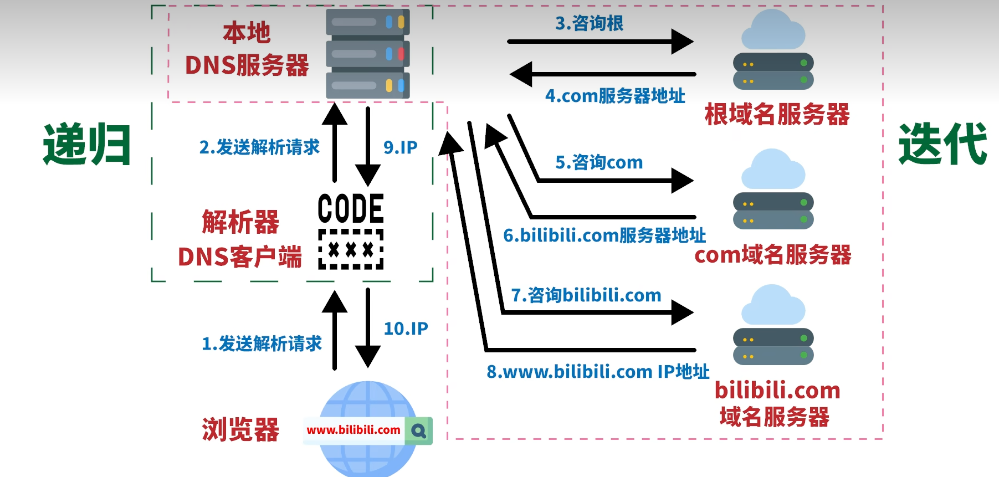

#### 常见DNS记录类型

- **`A`记录**：将域名指向一个**IPv4**地址
- **`AAAA`记录**：将域名指向一个**IPv6**地址
- **`CNAME`记录**： 域名别名，将一个域名指向另一个域名
- **`MX`记录**： 邮件交换记录，指定负责接收邮件的服务器

#### 递归查询和迭代查询

**递归查询**

DNS客户端向上层DNS服务器发起查询，并**要求这些服务器直接返回查询结果**

- 也就是说DNS客户端只需要发送一个查询请求，然后等待完整结果
- 上层DNS服务器会自行查询下一级服务器，将结果返回给DNS客户端

**迭代查询**

DNS客户端向上层DNS服务器发起查询，**但不要求这些服务器直接返回查询结果**

- DNS只从上层DNS服务器获取一个更高级的域名服务器地址，**然后自行向那个更高级的域名服务器发起查询**

### SSH

一种**加密的通信方式**，在SSH握手过程**使用非对称加密获得对称密钥**

#### 连接流程

- 进行TCP连接
- 进行SSH握手
- 客户端和服务端协商**SSH协议版本**
- 进行**密钥交换初始化**，协商应该使用什么**算法**
- 客户端生成**临时私钥**和**临时公钥**，将**临时公钥**发送给服务端
- 服务端生成**临时私钥**和**临时公钥**，将**客户端的临时公钥**和自己的**临时私钥**和**临时公钥**生成**共享安全密钥**
- 服务端将自己的**临时公钥**发送给客户端，客户端将**服务端的临时公钥**和自己的**临时私钥**和**临时公钥**生成**共享安全密钥**
- 服务端生成一对`host`公钥和`host`私钥，生成**交换哈希值**，并使用`host`私钥对交换哈希值进行加密，生成交换哈希值的**数字签名**，将**数字签名和`host`公钥**发送给客户端
- 客户端拿到服务端的`host`公钥对**数字签名**进行解密，并生成自己的**交换哈希值（客户端和服务端算出来的交换哈希值是一样的）**，比较二者是否一样

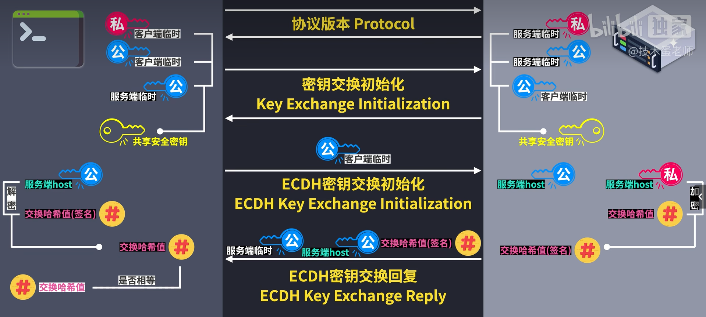

#### 交换哈希值

**构成：**

- 客户端和服务端的**版本号字符串**
- 客户端和服务端密钥交换初始化负载（**算法名称的字符串**）
- 服务端的`host`公钥
- 客户端临时公钥和服务端临时公钥
- 共享安全密钥

#### 使用SSH证书

在客户端使用`ssh-keygen`命令生成密钥对，**私钥放在本地，使用`ssh-copy-id`将公钥发送给服务器**，可以实现免密登录，**提高登录安全性**

### HTTP

**超文本传输协议**

- **无状态**（Stateless）：服务器不会记忆HTTP的状态，因此不需要额外的资源记录状态信息，减轻服务器负担
- **明文传输**（HTTP1.1以前）：有利于调试，但信息透明，不安全
- **可扩展**（Header可以自定义）
- 灵活（支持文本、图片、视频等多种资源类型）
- 请求-响应模型
- 默认端口是**80**

**核心概括**

- **HTTP/1.1**：持久连接、明文文本、队头阻塞
- **HTTP/2**：二进制分帧、多路复用、头部压缩
- **HTTP/3**：基于QUIC/UDP、解决TCP队头阻塞、集成TLS

**常见字段**

- `Host`：指定服务器的域名
- `Content-Length`：服务器回应的数据长度
- `Connection`：常用于 WebSocket，客户端要求服务端使用**HTTP 长连接机制**
- `Content-Type`：服务器回应时告诉客户端数据是什么格式
- `Content-Encoding`：说明数据的压缩方法

**缓存技术**

- **强制缓存**：只要浏览器缓存没有过期，则直接使用浏览器的本地缓存
  - 使用`Cache-Control`实现强制缓存，通过请求资源的时间与 Cache-Control 中设置的过期时间大小，来计算出该资源是否过期
- **协商缓存**：服务端告知客户端是否可以使用缓存
  - 服务端返回304，告诉浏览器可以使用本地缓存的资源

**跨域**

浏览器使用**同源策略**限制不同来源之间访问数据，协议、主机或端口任意一个不同，就属于不同源

- 简单请求直接通过，浏览器检查响应中的字段
- 发送非简单请求，浏览器会先发送一个预检请求，看服务端是否允许，允许则返回响应

**常见状态码**

- 1xx：提示信息，表示请求还在处理中，比如 100 Continue
- 2xx：成功处理请求，比如 200 OK
- 3xx：需要进一步操作，比如重定向，或者使用已经缓存的资源
  - 301：永久重定向
  - 302：临时重定向
- 4xx：客户端请求存在问题，比如参数错误、身份认证失败或者资源不存在
  - 400：请求格式有问题
  - 401：缺少有效的身份凭证
  - 403：权限不足
  - 404：资源不存在
  - 429：请求频繁，限流
- 5xx：服务端处理请求时发生错误，也包括网关访问上游服务失败
  - 500：服务器内部错误
  - 502：网关访问上游服务器失败
  - 503：服务暂时不可用
  - 504：网关等待上游服务器超时
  
**JWT、Cookie和Session**

- Cookie的存储位置是在客户端，当浏览器向服务器发起请求时会自动附带Cookie的数据
- Session的存储位置在服务端，服务器为每一个用户分配唯一的Session ID，服务端通过响应将这个 Session ID 传回给客户端，客户端后续请求都带上这个 Session ID，服务端根据 ID 查找对应数据。Session ID 通常存放在 Cookie 的位置，若浏览器禁用 Cookie，则 Session 也无法使用
- JWT组成部分：Header（头部，声明令牌类型和签名算法）、Payload（负载，存放实际传递的数据）、Signature（签名，对 Header 和 Payload 进行签名，防止篡改）
  - Header和Payload都是Base64Url编码，并非加密。验证时使用同样算法计算签名，和 Signature 比对，不一致则拒绝访问

#### HTTP/1.1

**默认都是长连接（Keep-Alive）**

只要客户端和服务端任意一端就没有断开连接，就保持TCP连接状态

**请求流水线**

在同一个TCP请求里面，客户端可以多次发起请求，第一次请求的响应还未返回便可以发送第二次请求，**解决了请求的队头阻塞，但是没有解决响应的队头阻塞**

**但是服务器必须按照请求顺序对这些请求做出响应**，因此有**队头阻塞**的问题

> **队头阻塞**：如果服务器在处理请求A耗时较长，那后续的请求都会被阻塞

**缺点**

- **无状态**：不需要额外资源记录状态信息，减轻服务器负担，但是在完成有关联性的操作时会非常麻烦
- **明文传输**：HTTP/1.1仍保持明文传输，有利于调试，但信息透明，不安全
- **报文格式**：使用**纯文本协议**，**明文传输**，（请求/响应是ASCII文本，头部和Body分界），**可读性高**
  - 每次请求/响应都**发送完整的头部**，存在大量重复开销
  - 报文首部不压缩，报文主体压缩
- 靠**多个TCP连接**并发加载资源，数据包丢失时容易造成**队头阻塞**

#### HTTP/2

**实现多路复用**

- **核心**是将每个请求/响应对抽象成**流**，每个流被拆分成多个带有ID的**帧**，服务器根据流ID对帧进行重组

-  在**一个**TCP连接上同时传输多个请求与响应，解决HTTP/1.1的**应用层队头阻塞问题**
-  但在**传输层仍然存在队头阻塞**的问题

**首部压缩**

- 使用`HPACK`算法对**请求头和响应头进行压缩**，降低传输压力
- 使用动态表与静态表减少冗余，降低带宽占用

**二进制分帧**

- 将数据分割成二进制帧进行传输，分为**首部帧**和**数据帧**等类型
- 将请求/响应拆分成更小的帧
  - 帧可以在**同一个TCP连接上交错发送和接收**
  - 每个帧包含唯一的流标识符（`Stream_ID`），服务器可按流独立组装

**传输层的队头阻塞**

- **HTTP2**在传输层使用了TCP协议，TCP协议必须保证接收到的字节是完整的，如果丢包了就会发生阻塞，导致字节留在内核缓冲区，服务器无法拿到数据

**缺点**

- **传输层的队头阻塞**
- **TCP与TLS的握手延迟**：发出HTTP请求时，需要进行**TCP三次握手和TLS四次信息交换**，**共计3RTT时延**才能发出请求数据
- **网络迁移需要重新连接**：一个TCP连接由【源IP地址，源端口，目标IP地址，目标端口】组成，如果IP地址或端口发生变化，需要重新建立TCP连接

#### HTTP/3

> HTTP/2队头阻塞的原因是因为传输层的TCP，在HTTP/3中将TCP改成了UDP

**核心**：整合

- 把传输层从**TCP**改为**QUIC（基于UDP）**，解决**TCP队头阻塞**问题
- 保留HTTP2的**二进制分帧**
- **握手**：在**QUIC中集成TLS1.3握手**

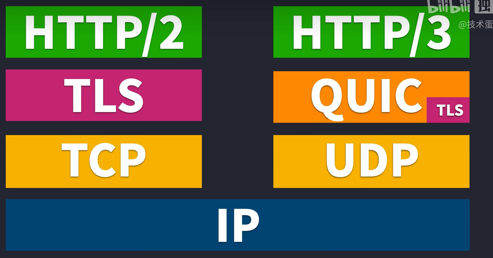

QUIC也支持在同一条连接上并发传输多个 Stream，每个Stream可以视作一个HTTP请求，**当某个流发生丢包时，只会阻塞这个流，其他流不会受到影响，因此不存在队头阻塞问题**

并且QUIC也支持连接迁移，基于TCP传输的HTTP是通过四元组（源 IP、源端口、目的 IP、目的端口）确定一条 TCP 连接，当网络变化时需要重新建立TCP连接，而**QUIC是通过连接ID来标记通信的两个端点**，只要连接ID没有发生变化，就可以复用原连接

### HTTPS

**核心**：通过**非对称加密**安全的交换一个**对称加密的会话密钥**

默认端口是**443**

是对`Http`的升级，后面的`S`指的是`SSL/TLS`

- `Https` = `Http` + `SSL/TLS`

- `SSL/TLS`是一种加密安全协议，可以对发起http请求的请求和响应进行加密

- `SSL`是`TLS`的前身，现在很多浏览器都支持`TLS`

**对称加密**

**加密和解密用的是同一个密钥**

- 发送方用密钥和加密算法**对明文进行加密**
- 接收方用密钥和加密算法**对密文进行还原**

分发密钥时就会遇到**挑战**，通过网络传输的话**密钥容易被黑客截取**，黑客可以很轻松对密文进行还原

**非对称加密**

**客户端和服务端各使用一把公钥和一把私钥，公钥可进行传递，用于加密，私钥不可泄漏，用于解密**

- 发送方在网络上获取公钥，用自己的**私钥**和公钥对信息进行加密
- 接收方同样用**私钥**和公钥对信息进行解密
- 黑客无法知道**私钥**是什么，也就无法解密信息

**SSL证书**

将网站的**身份信息与一个公钥**进行绑定，并由权威的**证书颁发机构（CA）**进行数字签名，证明其真实性

**TLS1.2握手流程（在这之前，服务端和客户端会进行TCP连接），四次握手**

1. 客户端发送`Client Hello`，TLS版本，加密套件和**第1随机数**（`Client Random`）给服务端
   - 第1随机数为一个由**客户端**生成的随机字符串
   - 客户端发送**它支持的加密套件列表**供服务端选择
2. 服务端发送`Server Hello`，TLS版本，加密套件和**第2随机数**（`Server Random`）给客户端
   - 第2随机数为一个由**服务端**生成的随机字符串
   - 此时返回给客户端服务端所选择的**加密套件**
3. 服务端发送**证书**给客户端
   - 证书包含了服务器的**公钥、域名、颁发机构、有效期**等信息
4. 服务端进行`Server Key Exchange`，发送自己的**临时公钥**
5. 服务端发送`Server Hello Done`，告诉客户端**信息发送完毕**
6. 客户端**验证证书**，如果证书不通过，连接中止
7. 客户端生成一个**预主密钥**，使用**服务端提供的公钥**进行加密，然后发送给**服务端**
8. 服务端利用自己的**私钥解密**得到**预主密钥**
   - 客户端和服务端按照**约定好的算法对这三个随机数生成相同的会话密钥**
9. 客户端告诉服务端**切换密码规范**，使用刚刚生成的**会话密钥**对会话内容进行加密
10. 客户端发送`Client Finished`完成消息
11. 服务端发送`Finished`消息

**TLS1.3将握手往返次数从2次减少到1次，显著降低了延迟，会话密钥都是由对方公钥加上自己的私钥和公钥生成的**

**握手总结**

- **预主密钥**是客户端生成的第3个随机数
- 后续的信息传输使用**会话密钥**

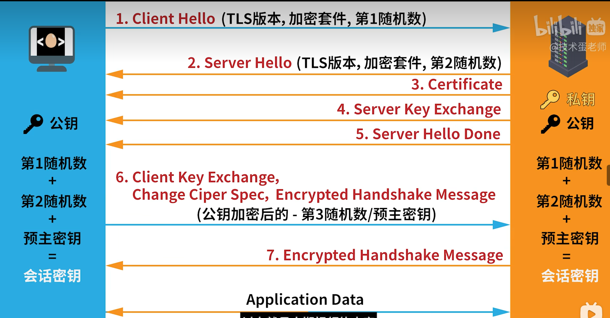

### WebSocket

特点：

- 全双工：客户端和服务端可以互相发送消息
- 独立协议：`ws://`或者`wss://`，通过 HTTP 协议 Upgrade 之后脱离 HTTP
- 基于TCP，连接建立在一条 TCP 连接上，默认端口是 80/443
- 需手动实现心跳、重连机制，使用 Ping/Pong 心跳机制
- 支持文本+二进制数据传输，传输时以**帧**为单位

**握手过程**（HTTP 1.1）

- 客户端发送 HTTP 请求，发送`Upgrade: websocket`和`Connection: Upgrade`头
- 服务端同意则回`101 Switching Protocols`，之后连接升级为 WebSocket 协议

**鉴权**

- 浏览器 websocket 原生 API 不支持自定义 Header，因此无法在请求头传递 JWT Token
- 可以把 token 放在查询参数里，但容易在服务器日志留下痕迹
- 也可以进行**首条消息鉴权**，连接建立后，客户端先发一条包含 token 的消息，服务端验证通过后才允许后续通信

**Go管理websocket**

- Hub + Client + Write Dump + Read Dump
- Hub 是连接管理中心
- Client 是客户端
- Write Dump 是写泵，负责向客户端写入消息
- Read Dump 是读泵，负责从连接读取信息

### SSE

SSE 全称 Server-Sent Events，是一种基于 HTTP 的服务端向客户端推送事件的机制

特点：

- 服务端向客户端推送
- 基于 HTTP 协议，无需进行协议升级

**HTTP Header**

|Header|作用|
|---|---|
|Content-Type: text/event-stream|告诉浏览器这是 SSE 事件流|
|Cache-Control: no-cache|避免缓存事件流|
|X-Accel-Buffering: no|禁止 Nginx 对该响应进行缓冲|
|Connection: keep-alive|HTTP/1.1 下表示保持连接|

**SSE 数据格式**

- `id`：当前事件ID
- `retry`：断线后的重连等待时间，单位毫秒
- `event`：自定义事件类型
- `data`：消息内容

**断线重连**

- 浏览器提供`EventSource`API
- 浏览器有3个连接状态
  - `CONNECTING(0)`：正在连接或等待重连
  - `OPEN(1)`：连接已建立
  - `CLOSED(2)`：连接已关闭

### QUIC

**对协议层进行重构**

- 融合了`HTTP2`、`TLS`、`TCP`的特征
- 顶层使用`HTTP3`
- 传输层使用`UDP`
- 使用`QPACK`进行数据压缩

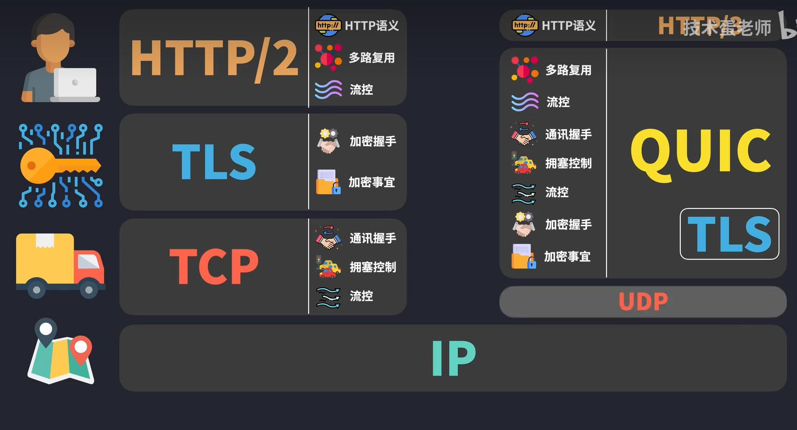

**QUIC数据包**

- 应用数据**拆分**成QUIC流
- QUIC流**组合**成QUIC帧
- QUIC帧**连接**成QUIC包

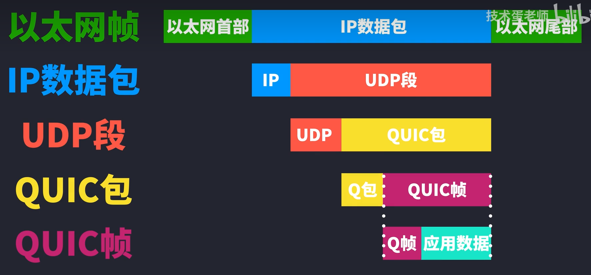

**传输时延**

- 首次通信是1RTT，此时**首部数据会较长**，后续加密通信**首部会较短**
- 通信的恢复是0RTT

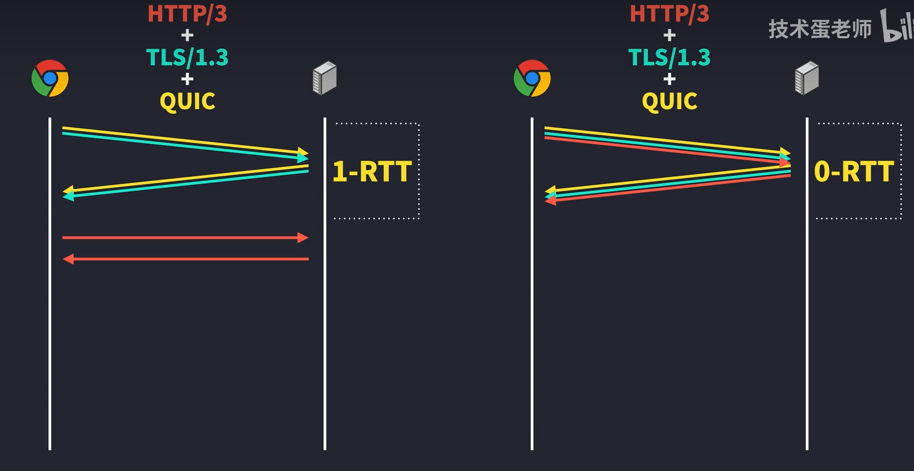

**加密**

- QUIC对连接ID等信息进行了加密
- 导致ISP难以根据连接ID进行流量监测

### RPC

**远程过程调用**：`Remote Procudure Call`

- 基于UDP/TCP等传输层协议，也可以配合HTTP等应用层协议
- 在分布式系统中，让一个应用像调用本地函数一样去调用另一台机器上的方法，拥有**跨语言能力**
- 有多种实现，如`grpc`、`Dubbo`等
- **序列化方法**也有多种实现，常见有`protobuf`等

**流程**

- 客户端发起调用
- 客户端存根（`stub`）处理，对**函数名、数据等**进行**序列化**，封装成网络信息
- 网络传输
- 服务端接收
- 服务端存根（`skeleton`），对请求进行**反序列化**，还原出函数名和参数
- 服务端执行业务代码
- 服务端存根将结果进行**序列化**并发送给客户端
- 客户端对传输数据**反序列化**出结果

#### grpc

rpc的一种实现方法，由Google实现

- 支持多种语言
- 基于IDL文件定义服务
- 基于HTTP2设计
- 序列化支持`Protocol Buffer`和`JSON`
  - `PB`使用`.proto`文件定义**数据结构和接口规范**，使用自带的编译器为**多种编程语言**生成对应的代码
    - 包括**消息结构体、客户端和服务端接口代码**
  - `protobuf`比`JSON`小3-10倍，解析速度快5-20倍左右
- 支持拦截器：**Unary interceptor**（一元）和**Stream interceptor**（流式）
- `metadata`，元数据，类似HTTP的header，可以存放`token`、`rid`等

**通信模式**

- 一元RPC（`Unary RPC`）：客户端发送**单个请求**，服务器返回**单个响应**
- 服务端流式RPC（`Server Streaming RPC`）：客户端发送**单个请求**，服务器返回**多个响应（数据流）**
- 客户端流式RPC（`Client Streaming RPC`）：客户端发送**多个请求（数据流）**，服务端返回**单个响应**

- 双向流式RPC（`Bidrectional Streaming RPC`）：客户端和服务端都可以发送**多个请求/响应**

