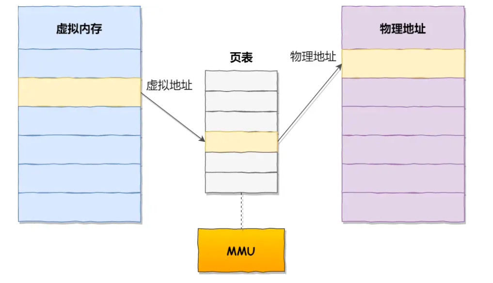
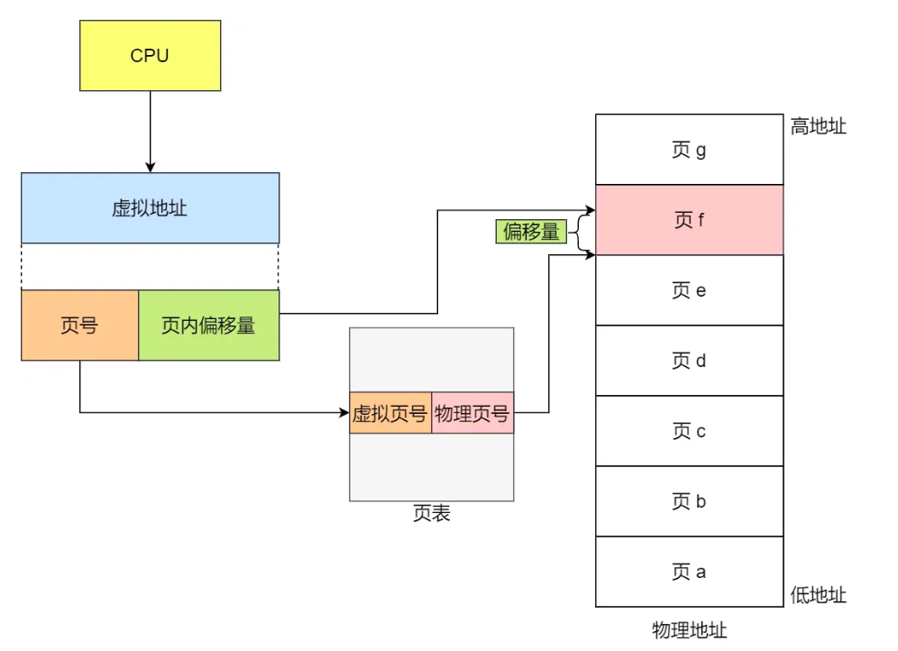
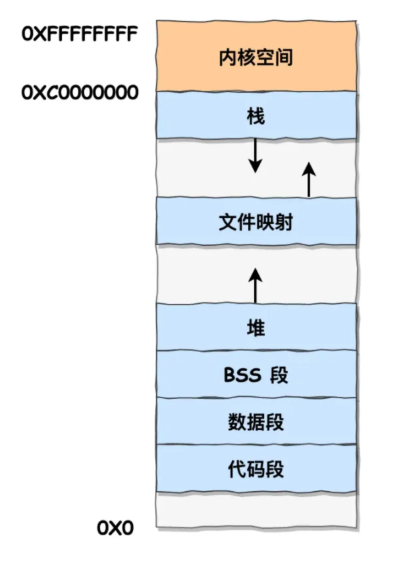
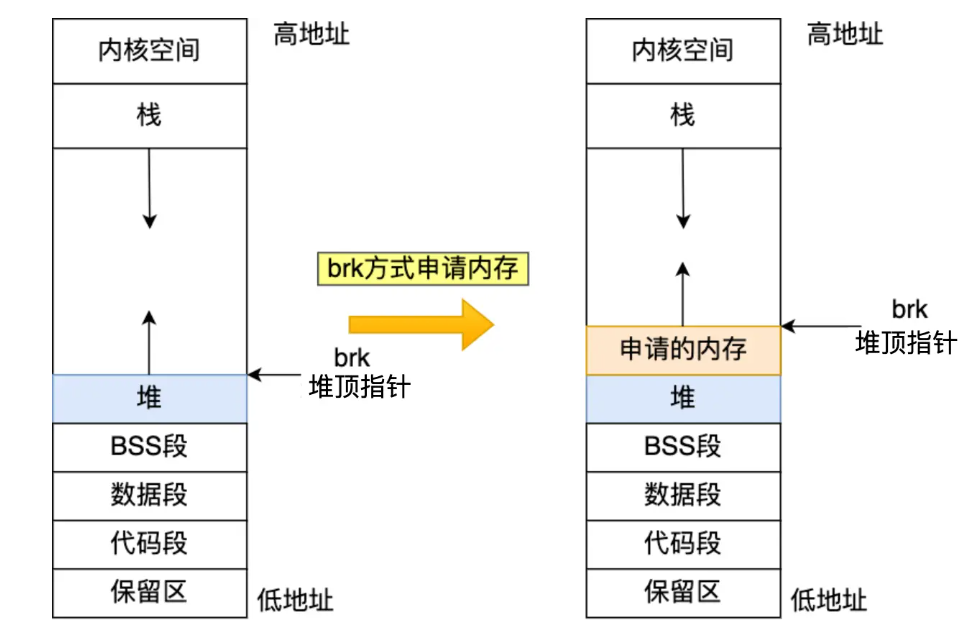
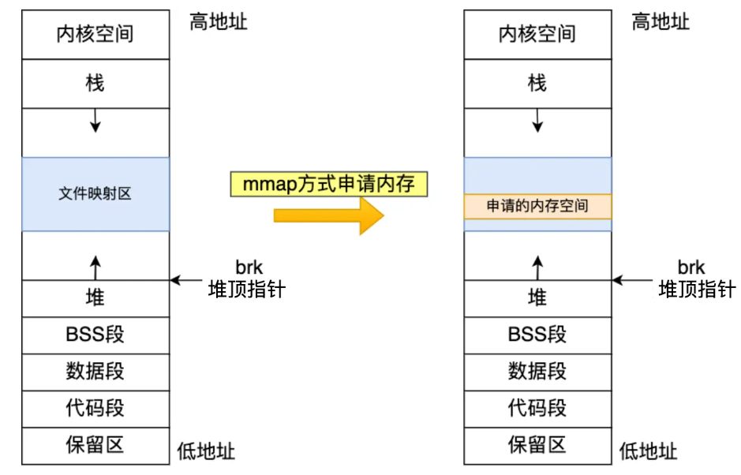

[本页PDF](/pdfs/me/formulaic/os.pdf)

## 用户态和内核态

内核态运行在ring0，用户态运行在ring3，root用户也是运行在用户态

用户态进入内核态的情况：

- 系统调用
- 异常
- 外部中断

## 进程与线程

**区别**

- 进程是**操作系统资源分配**的基本单位，线程是**任务调度和执行**的基本单位
  - 资源主要指的是虚拟地址空间、打开的文件描述符、网络连接，以及权限和资源限制等运行环境
- 进程有**独立的虚拟地址空间**，进程切换需要切换地址空间。同一进程内的线程共享代码、堆和全局变量，每个线程有自己的运行栈、寄存器和程序计数器

**并发和并行**

- 并发：多个任务在同一段时间内交替推进，不要求在同一个时刻执行
- 并行：多个任务在同一个时刻同时执行，通常需要多个 CPU 核心

**进程切换与线程切换**

- 进程切换需要切换虚拟地址空间、页表指针，保存和恢复程序计数器，寄存器，栈指针等状态
- 同一进程内的线程切换在进程内执行，**不需要切换地址空间**，但也需要保存和恢复执行状态，**节省的是地址空间切换的开销**

**进程的五种状态**

**僵尸进程和孤儿进程**

- 僵尸进程：子进程已经退出，但父进程还没有回收他的退出状态，导致子进程的进程描述符仍然留在系统里
  - 子进程代码、数据、内存都释放了，只剩一个空的 PCB
- 孤儿进程：父进程先于子进程结束，子进程还活着，但失去了父进程
  - 孤儿进程被 init/systemd 收养，成为它的新父进程

**信号和信号量**

- 信号：一种处理异步事件的方式，用于通知接收进程有某种事件发生，除了用于进程外，还可以发送信号给进程本身
- 信号量：资源计数器，用于控制多个执行流对共享资源的并发访问数量
  - P操作：计数器减 1，如果小于0，**阻塞等待**
  - V操作：计数器加 1。如果有等待者，**唤醒一个**

**进程调度算法**

- 先来先服务调度算法：从就绪队列取出作业运行，一个一个来，短作业等待的时间会变长，对短作业不利
- 最短作业优先调度算法：优先选择运行时间最短的作业运行，对长作业不利
- 高响应比优先调度算法：权衡了短作业和长作业，每次先计算响应比优先级，优先级最大的优先执行
  - 的
- 时间片流转调度算法：每个进程被分配一个时间段，该进程只能在这个时间段内运行
  - 时间片用完，进程还在执行，进程会被释放，CPU会被另外一个进程使用
  - 时间片没用完，进程已经执行完毕，CPU立刻执行切换
- 最高优先级调度算法：

## 内存管理

**操作系统内存管理**：设置了虚拟内存，每个进程都有自己的独立虚拟地址空间

- 进程可以使用比物理内存更大的虚拟空间，不必把所有页面同时放进物理内存
- 每个进程都有自己的页表，每个进程的虚拟内存空间是独立的
- Linux通过分页来管理内存，页大小一般是4kb

**虚拟内存和物理内存之间通过页表来映射**

- 页表存储在内存里
- 内存管理单元（MMU）就做将虚拟内存地址转换为物理地址的工作

**缺页异常**：MMU发现要访问的虚拟页当前**不在物理内存里或不允许访问**，于是主动陷入内核，让 OS 来处理的一种异常

- 内核会判断这次访问是否合法，合法的按需分配，写时复制后可以重试
- 不合法的如地址非法或权限错误，则可能杀死进程，向进程发送 SIGSEGV

**页表**

- **虚拟地址**：分为页号和页内偏移量两部分
- 内存地址转换
  - 把虚拟内存地址切分为页号和偏移量
  - 从页表里面根据页号查询对应的物理页号
  - 用物理页号乘以页大小，得到物理页框的基地址，再加上页内偏移量，就得到了物理地址

**多级页表**

主要是为了**减少稀疏地址空间下页表占用的内存**。单级页表在虚拟地址空间很大时，页表本身会大到不可接受

- 只为实际使用的地址范围分配下一级页表
- 代价是地址转换时，可能需要沿着多级页表查询，增加访存次数，CPU会用TLB解决这个问题

**TLB**

快表，CPU内部的小容量、高速缓存，存储**虚拟内存页号和物理页框号的映射**

- 访问内存时，CPU先查TLB，命中后就不需要再查多级页表
- 未命中时再查多级页表

**程序的内存布局**

- 代码段：二进制可执行代码
- 数据段：通常包括已初始化且非零的全局变量和静态变量，只读常量通常放在只读数据区域
- BSS段：未显式初始化或者初始化为0的全局变量和静态变量
- 堆段：动态分配的内存，低地址向上增长
- 栈段：函数调用的上下文和需要放在栈上的变量等，大小有限制

**堆和栈的区别**

- 分配方式：堆的内存由malloc、new等方式申请，栈空间则随着函数调用建立和回收
- 内存管理：堆内存通常由程序或者垃圾回收器进行管理，栈上的内存通常随函数返回自动回收
- 大小和速度：堆空间比较大，分配和释放内存需要时间开销；栈大小有限，内存分配和释放速度快

**写时复制**

发生写操作时，系统才去复制物理内存，否则父子进程共用页表，指向同一片物理内存

- **有利于节省物理内存，以及立即复制大量数据的 CPU 时间**

**brk和mmap**

- `brk`：调整进程自己的堆顶指针，分配内存是连续的

- `mmap`：在进程的虚拟地址空间找一块空闲区域，把他映射到物理内存上

**操作系统内存不足时会发生什么**

先尝试回收内存，若回收后内存还不够，触发OOM

**页面置换算法**

需要新页面但可用物理内存不足时，选择可以回收或换出的页面

## 锁

**互斥锁和自旋锁**

- 互斥锁：拿不到锁时，线程进入睡眠（阻塞），锁释放后唤醒线程
- 自旋锁：拿不到锁时，反复检查锁是否释放，不进入睡眠
  - 多核中使用，单核使用会造成死锁

**死锁的四个条件**：同时满足下面四个条件才会发生

- 互斥条件：多个线程不能同时使用一个资源
- 持有并等待条件：线程已经有了资源A，又想申请资源B，但资源B已经被其它线程持有了，这个线程就会处于等待状态，但其并不会释放资源A
- 不可剥夺条件：当线程已经持有资源，自己使用完之前不能被其它线程获取
- 环路等待条件：存在一个等待环，环里可以有两个以上的线程

**银行家算法**

## 网络i/o